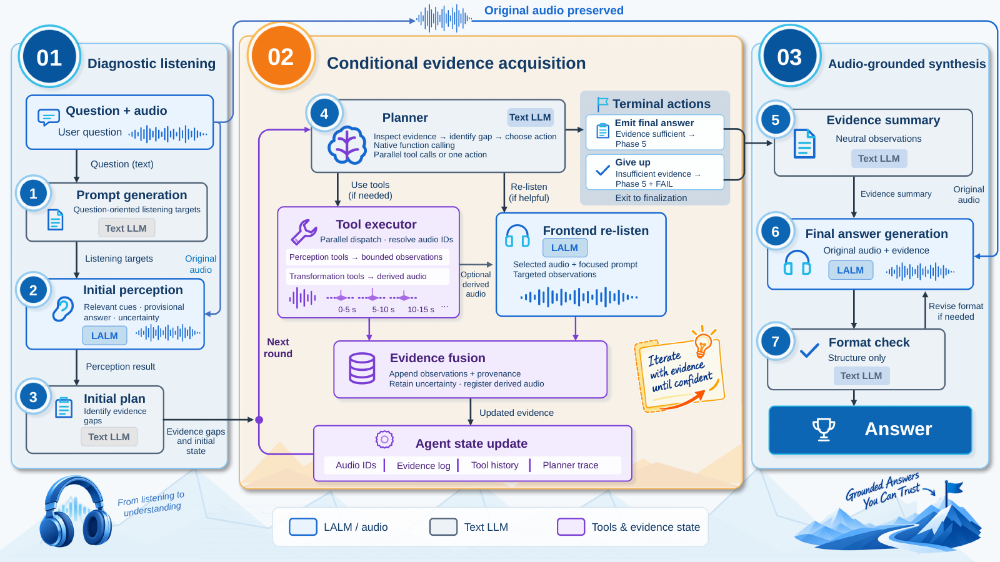
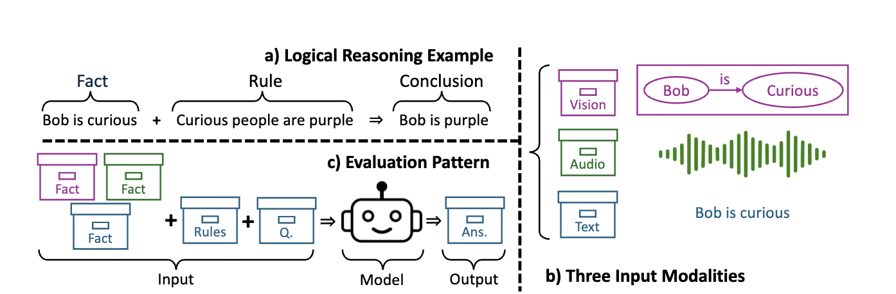
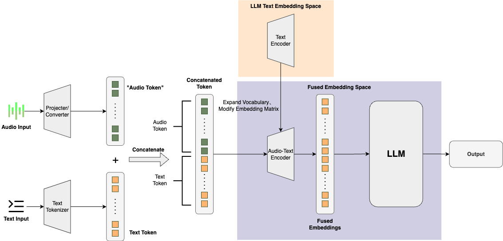
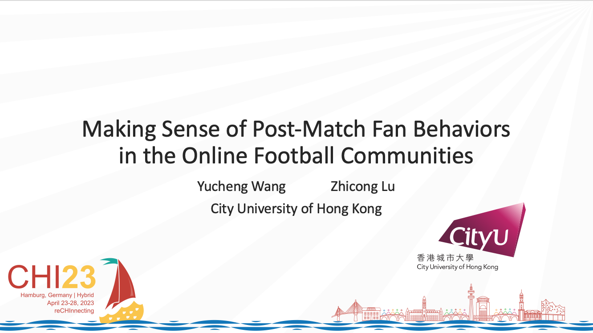
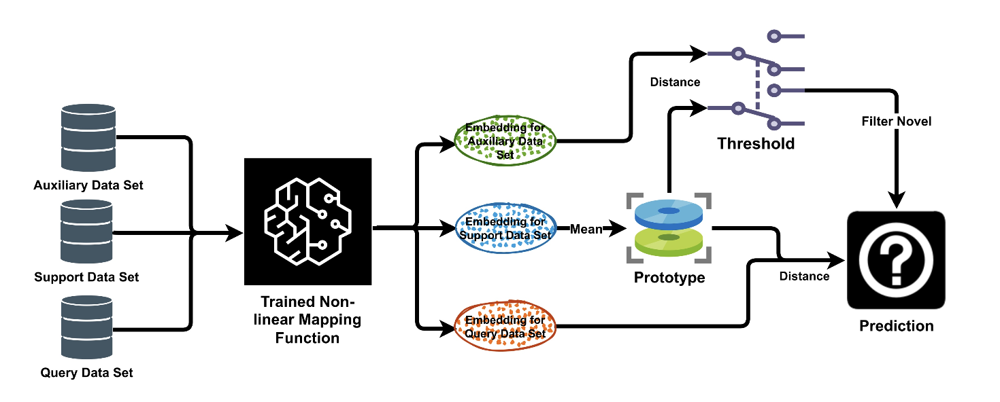
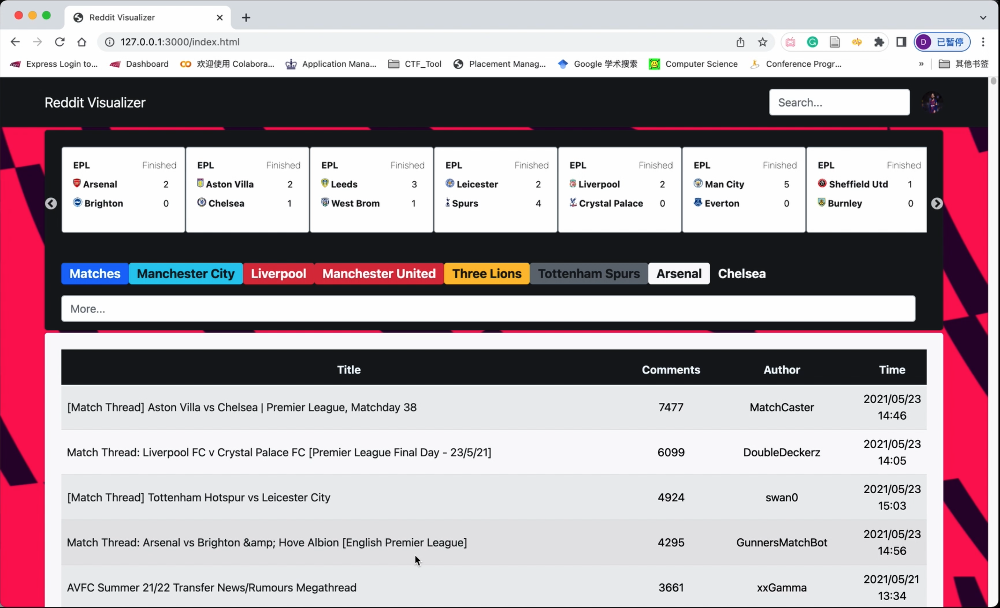
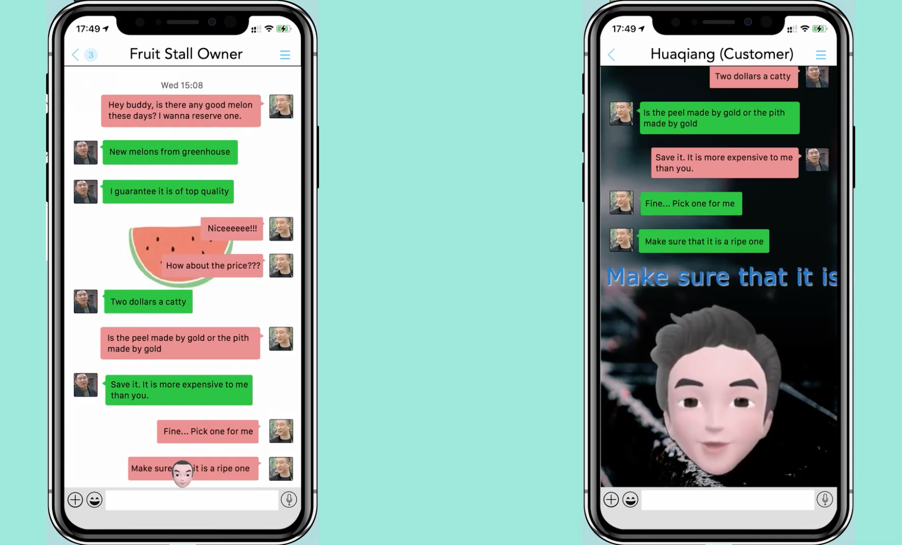
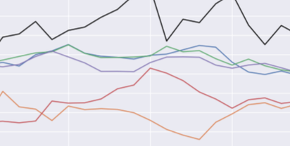
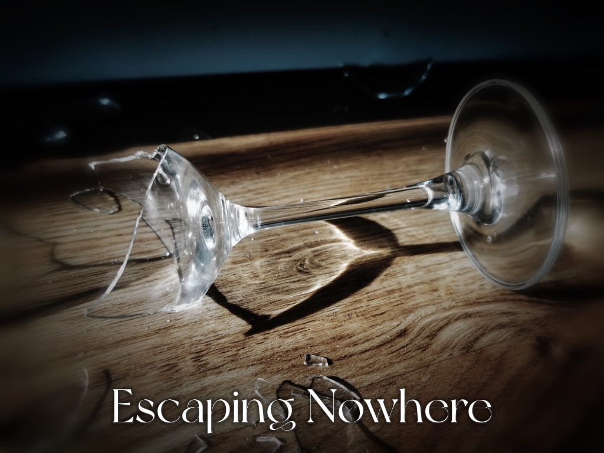

  

    <section class="hero" id="about">
      

        <h1 class="hero__title">Yucheng Wang</h1>
        

          I am a second-year master's student at <a href="https://ethz.ch/en.html">ETH Zürich</a>, majoring in Computer Science
          with a specialization in Machine Intelligence. I obtained my Bachelor's degree in Computer Science at
          <a href="https://www.columbia.edu/">Columbia University</a> and <a href="https://www.cityu.edu.hk/">City University of
          Hong Kong</a> in 2024, as part of the <a href="https://cityu-hk.gs.columbia.edu/">Joint Bachelor's Degree Program</a>
          between these two institutions. Previously, I interned at Tencent AI Lab and
          <a href="https://www.aispeech.com/">AISpeech</a>.
        

        

          My research focuses on multimodal large language models, with a particular emphasis on audio.
          I am especially interested in <strong>multimodal reasoning</strong>: how LLMs understand and use fine-grained
          details in multimodal content. I also study <strong>voice agents</strong>, aiming to build more capable systems that
          provide natural and intuitive interfaces for <strong>human-computer interaction</strong>.
        

      

      

        
        

          
MSc CS @ ETH Zürich

          
Suzhou · Hong Kong · New York · Zürich

        

      

      

        <a class="hero__link" href="mailto:yuchwang@ethz.ch">
          <i class="fas fa-envelope" aria-hidden="true"></i>Email
        </a>
        <a class="hero__link" href="/assets/Resume_Wang_Yucheng.pdf">
          <i class="far fa-file-alt" aria-hidden="true"></i>CV
        </a>
        <a class="hero__link" href="https://scholar.google.com/citations?user=l_-Dt48AAAAJ&hl=en">
          <i class="fas fa-graduation-cap" aria-hidden="true"></i>Google Scholar
        </a>
        <a class="hero__link" href="https://github.com/DELTA-DoubleWise">
          <i class="fab fa-github" aria-hidden="true"></i>GitHub
        </a>
      

    </section>

    <section class="section section--entries" id="publications">
      

        <h2 class="section__title">Selected Publications</h2>
      

      

        <article class="entry">
          

            
          

          

            
<time datetime="2026-05">May 2026</time> • Publication

            <h3 class="entry__title">
              <a href="https://arxiv.org/pdf/2605.28480">Audio-Mind: An Auditable Agentic Framework for Audio Understanding</a>
            </h3>
            
<u>Yucheng Wang</u>*, Jing Peng*, Hanqi Li, Chenghao Wang, Wenming Tu, Yu Xi, Zhaokai Sun, Kai Yu, Shuai Wang

            
<em>Preprint, 2026</em>

            

              <a class="button button--outline-primary button--rounded button--sm" href="https://arxiv.org/pdf/2605.28480">PDF</a>
            

            
An audio understanding agent that acquires evidence through tools and targeted re-listening to produce auditable answers.

          

        </article>

        <article class="entry">
          

            
          

          

            
<time datetime="2026-01">Jan 2026</time> • Publication

            <h3 class="entry__title">
              <a href="https://arxiv.org/pdf/2509.23744">COMPOSE AND FUSE: Revisiting the Foundational Bottlenecks in Multimodal Reasoning</a>
            </h3>
            
<u>Yucheng Wang</u>*, Yifan Hou*, Aydin Javadov, Mubashara Akhtar, Mrinmaya Sachan

            
<em>Accepted at ICLR 2026</em>

            

              <a class="button button--outline-primary button--rounded button--sm" href="https://arxiv.org/pdf/2509.23744">PDF</a>
            

            
A controlled study identifying task-composition and modality-fusion bottlenecks in reasoning across text, vision, and audio.

          

        </article>

        <article class="entry">
          

            
          

          

            
<time datetime="2025-06">Jun 2025</time> • Publication

            <h3 class="entry__title">
              <a href="https://arxiv.org/abs/2410.18908">A Survey on Speech Large Language Models for Understanding</a>
            </h3>
            
Jing Peng*, <u>Yucheng Wang</u>*, Bohan Li, Yiwei Guo, Hankun Wang, Yangui Fang, Yu Xi, Haoyu Li, Xu Li, Ke Zhang, Shuai Wang, Kai Yu

            
<em>IEEE Journal of Selected Topics in Signal Processing (JSTSP), 2025</em>

            

              <a class="button button--outline-primary button--rounded button--sm" href="https://arxiv.org/pdf/2410.18908">PDF</a>
            

            
A systematic review of speech LLM architectures, training strategies, datasets, evaluation methods, and open challenges.

          

        </article>

        <article class="entry">
          

            
          

          

            
<time datetime="2023-04">Apr 2023</time> • Publication

            <h3 class="entry__title">
              <a href="https://dl.acm.org/doi/full/10.1145/3544548.3581310">Making Sense of Post-match Fan Behaviors in the Online Football Communities</a>
            </h3>
            
<u>Yucheng Wang</u>, Zhicong Lu

            
<em>Proceedings of the 2023 CHI Conference on Human Factors in Computing Systems</em>

            

              <a class="button button--outline-primary button--rounded button--sm" href="/assets/pdf/3544548.3581310.pdf">PDF</a>
            

            
Examines how match results relative to fans' expectations shape sentiment, discussion topics, and voting on Reddit.

          

        </article>
      

    </section>

    <section class="section section--entries" id="projects">
      

        <h2 class="section__title">Selected Projects</h2>
        
Course projects and applied research systems.

      

      

        <article class="entry">
          

            
          

          

            
<time datetime="2024-05">May 2024</time> • Project

            <h3 class="entry__title">
              <a href="https://github.com/DELTA-DoubleWise/Identity_Preserved_Images_Generation">Identity-Preserving Comic Story Generator</a>
            </h3>
            

              Course project for COMS4995 Applied Computer Vision at Columbia University. The system combines
              StableIdentity with Stable Diffusion XL to generate personalized comic stories with identity-preserved images.
            

            

              <a class="button button--outline-primary button--rounded button--sm" href="/assets/pdf/Applied_CV_Report.pdf">PDF</a>
            

          

        </article>

        <article class="entry">
          

            
          

          

            
<time datetime="2023-12">Dec 2023</time> • Project

            <h3 class="entry__title">Refined Prototypical Network for Hierarchical Few-shot Image Classification</h3>
            

              Course project for COMS4995 Neural Networks &amp; Deep Learning at Columbia. We revised the prototypical
              network to generalize to unseen classes in hierarchical few-shot image classification.
            

            

              <a class="button button--outline-primary button--rounded button--sm" href="/assets/pdf/NNDL_Report.pdf">PDF</a>
            

          

        </article>

        <article class="entry">
          

            
          

          

            
<time datetime="2022-06">Jun 2022</time> • Project

            <h3 class="entry__title"><a href="/project/vis_sys">Reddit Visualizer</a></h3>
            

              Extended visualization system for the Final Year Project on online community user behavior patterns.
              This work supports the CHI 2023 publication and was selected as a CityU Outstanding Academic Paper in 2022.
            

          

        </article>

        <article class="entry">
          

            
          

          

            
<time datetime="2021-12">Dec 2021</time> • Project

            <h3 class="entry__title"><a href="https://github.com/CS334Group23/mahjong">Mahjong Legend [麻雀传奇]</a></h3>
            

              Group project for CS3343 Software Engineering Practice at CityU. A single-player mahjong game based on
              Hong Kong rules, designed for beginners with an AI opponent.
            

          

        </article>

        <article class="entry">
          

            
          

          

            
<time datetime="2021-12">Dec 2021</time> • Project

            <h3 class="entry__title">Message Animation: a Facial Animation based Instant Messaging App</h3>
            

              Group project for CS3483 Multimodal Interface Design at CityU. The app converts vocal or text messages
              into expressive cartoon animations for richer messaging.
            

            

              <a class="button button--outline-primary button--rounded button--sm" href="/assets/pdf/3483_Project_Final_Report_Group21.pdf">PDF</a>
            

          

        </article>

        <article class="entry">
          

            
          

          

            
<time datetime="2021-06">Jun 2021</time> • Project

            <h3 class="entry__title">Daily Hang Seng Index Trend Prediction applying Deep Learning</h3>
            

              Research mentoring study on predicting daily Hang Seng Index trends using LSTM and its variants.
            

            

              <a class="button button--outline-primary button--rounded button--sm" href="/assets/pdf/RMS Final Report Wang Yucheng 56198686.pdf">PDF</a>
            

          

        </article>
      

    </section>

    <section class="section" id="music">
      

        <h2 class="section__title">Music</h2>
        
Original compositions and experiments.

      

      

        <article class="entry entry--compact">
          

            
          

          

            
<time datetime="2023-06">Jun 2023</time> • Music

            <h3 class="entry__title">
              <a href="https://soundcloud.com/yucheng-wang-924885956/escaping-nowhere?si=12aa366fdfeb4a988bc708e3e8c29c27&utm_source=clipboard&utm_medium=text&utm_campaign=social_sharing">Escape Nowhere</a>
            </h3>
            

              Original beat. Waking up from the indulgence of your dreams and face the repression of your real life.
            

          

        </article>
      

    </section>
  

